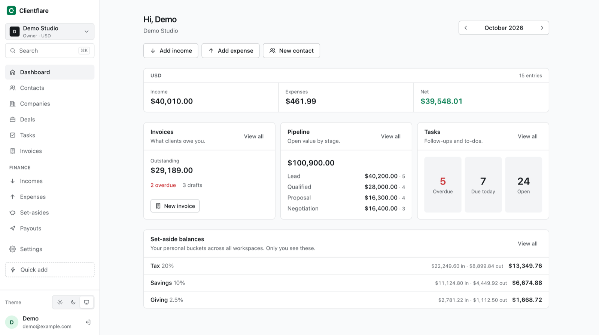
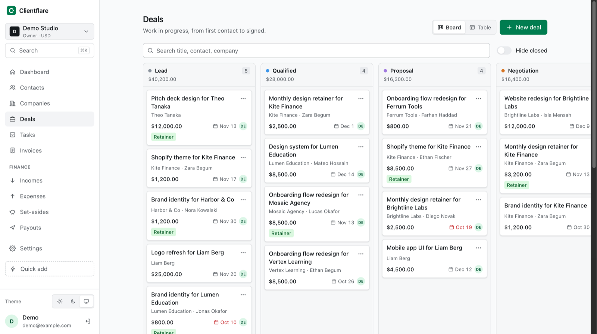
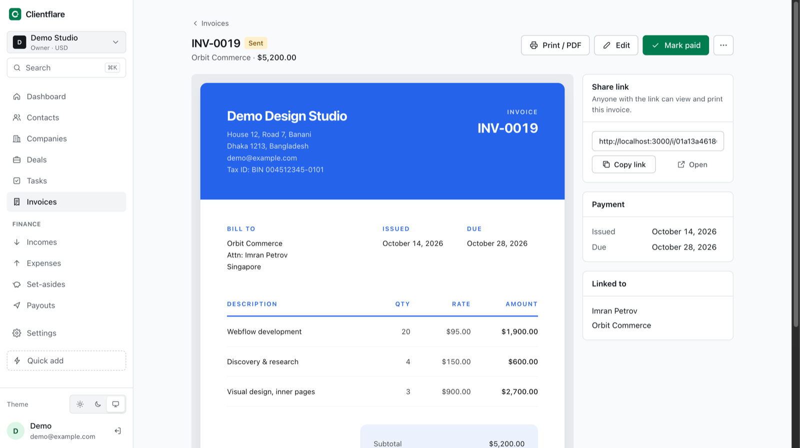

<p align="center">
  <picture>
    <source media="(prefers-color-scheme: dark)" srcset="docs/assets/logo-dark.svg">
    
  </picture>
</p>

<p align="center">
  CRM and invoicing for freelancers and small agencies.<br>
  Free, open source, and running on your own Cloudflare account.
</p>

<p align="center">
  <a href="https://deploy.workers.cloudflare.com/?url=https://github.com/sarequl/clientflare"></a>
</p>

<p align="center">
  <a href="https://github.com/sarequl/clientflare/actions/workflows/ci.yml"></a>
  <a href="LICENSE"></a>
  <a href="https://github.com/sarequl/clientflare/releases"></a>
</p>

<p align="center">
  <picture>
    <source media="(prefers-color-scheme: dark)" srcset="docs/assets/dashboard-dark.png">
    
  </picture>
</p>

## Why

Freelancer tools charge \$20 to \$60 a month to join the same five steps: lead, deal, invoice, payment, bookkeeping. Clientflare does those steps in one app that deploys to your own Cloudflare account in a click, fits the Workers free tier for a solo user, and keeps your data in a D1 database you own. There is no hosted version and no account with us. Clone it, deploy it, it's yours.

## What you get

- **Contacts and companies** with tags, custom fields, CSV import and export, and a timeline of notes, calls, meetings and changes.
- **Deals** on a drag-and-drop pipeline, with win and loss tracking and a table view.
- **Tasks** with due dates and a morning digest email.
- **Invoices** that go from draft to sent to paid, with four templates, a public link your client can print, and revisions after sending. Paid invoices flow into income automatically.
- **Personal finance**: income, expenses, set-aside rules (tax, savings, giving) and payouts, per currency. Private to you, even inside a shared workspace.
- **Client portal** where customers see their invoices, shared notes and files through a magic link.
- **Workspaces** with owner, admin and member roles, email invites, and several businesses on one install.
- **MCP server**, so Claude, Cursor or any MCP client can work your CRM for you.
- **Light and dark themes**, keyboard search, and a quick-add screen that works as a phone home-screen app.

<p align="center">
  
</p>

<p align="center">
  
</p>

## Deploy

**One click.** Press the button at the top. Cloudflare forks the repo into your GitHub, creates the D1 database and R2 bucket, asks for the secrets below, and deploys. Every push to your fork redeploys.

**By hand.**

```sh
git clone https://github.com/sarequl/clientflare && cd clientflare
pnpm install
wrangler login
pnpm deploy                              # build, deploy, provision D1 + R2, run migrations
wrangler secret put BETTER_AUTH_SECRET   # paste the output of: openssl rand -base64 32
wrangler secret put RESEND_API_KEY       # optional until you want email
```

| Setting | Required | Notes |
| --- | --- | --- |
| `BETTER_AUTH_SECRET` | yes | Signs sessions. Any 32+ byte random string. |
| `RESEND_API_KEY` | no | Sign-in links, invites and digests. Without it, nothing is emailed. |
| `EMAIL_FROM` | with Resend | A sender on a domain your Resend account verifies. Set in `wrangler.jsonc`. |
| `APP_URL` | no | Leave empty; the app uses whatever hostname it is served from, custom domains included. |

Open your Worker's URL, create the first account, and the setup wizard takes it from there. Later releases are a `git pull` and `pnpm deploy`; migrations run as part of it.

## Talk to it from Claude (MCP)

Every deployment is an MCP server at `/api/mcp`. Create a token under **Settings → API & MCP**, then:

```sh
claude mcp add --transport http clientflare https://your-app.workers.dev/api/mcp \
  --header "Authorization: Bearer cf_…"
```

The settings page gives you the equivalent JSON for Claude Desktop, Cursor and VS Code. A token acts as you inside one workspace, so everything it does shows up on the timeline under your name.

Tools: `search`, `whoami`, contacts (list, get, create, update), companies (list, get, create), deals (list, get, create, move, stages), tasks (list, create, complete), `log_activity`, invoices (list, get, create as draft), `finance_summary`. Sending an invoice stays a human action in the app.

## Local development

```sh
pnpm install
cp .dev.vars.example .dev.vars   # set BETTER_AUTH_SECRET
pnpm db:migrate                  # applies ./drizzle to the local D1
pnpm seed:demo                   # optional: demo@example.com / demo1234 with six months of data
pnpm dev                         # http://localhost:3000
```

Without `RESEND_API_KEY`, sign-in links and invites print to the terminal. `pnpm build && pnpm typecheck && pnpm test` is what CI runs.

Schema changes: edit `src/db/schema/*.ts`, then `pnpm db:generate` writes a migration into `drizzle/` and `pnpm db:migrate` applies it locally. If you change Better Auth plugins, run `pnpm auth:generate` first.

## Stack

| Layer | Choice |
| --- | --- |
| Runtime | One Cloudflare Worker |
| App | TanStack Start (React 19, Vite), SSR and server functions |
| Database | D1 via Drizzle ORM |
| Files | R2 |
| Auth | Better Auth (email and password, magic link, organizations as workspaces) |
| Email | Resend |
| Styling | Tailwind v4, no component library |

```
src/
  db/schema/        Drizzle tables (auth.ts is generated by Better Auth)
  features/<name>/  server functions per module
  lib/              auth, session, email, money, ids, origin
  routes/           TanStack file routes, /api/auth, /api/mcp, /api/files
  components/       shared UI, invoice templates
drizzle/            SQL migrations
scripts/            demo seed, MCP probe
```

## Roadmap

v1 is done. [docs/roadmap.md](docs/roadmap.md) lists what's shipped and what's next: payment links, recurring invoices, quotes, projects and time tracking, email sync, proposals and e-signature.

## Contributing

Issues and pull requests are welcome. [CONTRIBUTING.md](CONTRIBUTING.md) has the short version; [CLAUDE.md](CLAUDE.md) is the map of the codebase, written for coding agents and useful to humans. Security reports go through [SECURITY.md](SECURITY.md).

## Licence

[AGPL-3.0](LICENSE). Run it, change it, host it for yourself freely. If you host a modified version for other people, publish your changes.
